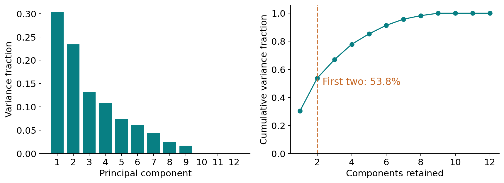
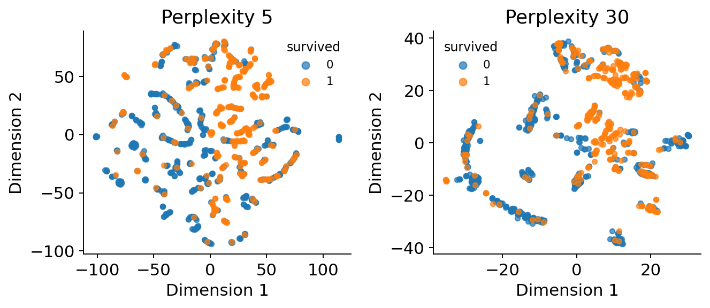
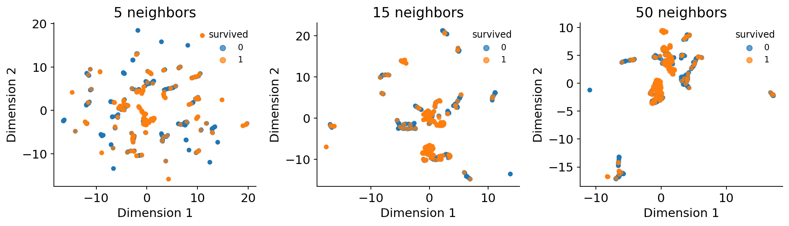
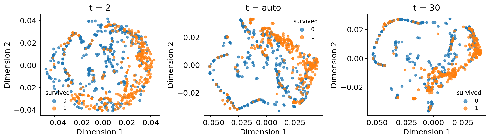
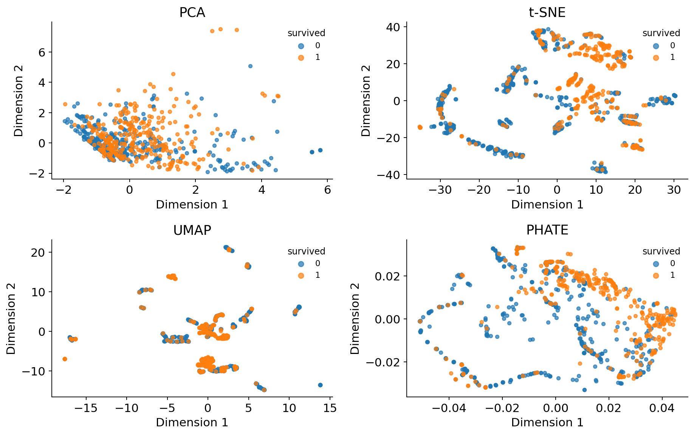

## PCA

PCA forms linear combinations of centered features. Its first direction maximizes projected variance, and subsequent directions are perpendicular and capture the remaining variation. Component weights describe directions across features, while scores describe the coordinates of observations along them.

For centered X, the SVD is X = U Sigma V transpose. The columns of V are component directions, and U Sigma gives scores. With n observations, squared singular values divided by n-1 give covariance eigenvalues. Retaining two components produces an n-by-2 table of plotted coordinates.

PCA is a fast and interpretable baseline. Scaling changes the directions, large variance need not answer the substantive question, and a linear projection can hide nonlinear structure. In the supplied Titanic preparation, the first two components retain **53.8%** of feature variance.

## t-SNE

t-SNE converts high-dimensional similarities into probabilities, using adaptive local scales. A heavy-tailed low-dimensional similarity model helps address crowding. It optimizes point positions to match the similarity patterns, with particular sensitivity to local relationships.

Perplexity sets an effective neighborhood scale rather than an exact neighbor count. Different scales or initializations can change the layout. Inspect group profiles in the original variables before interpreting apparent islands. Between-island distances, areas, and densities are not faithful measurements of the original space.

## UMAP

UMAP constructs locally scaled neighborhood relationships, combines them into a weighted graph, and optimizes a low-dimensional representation. `n_neighbors` affects neighborhood context. `min_dist` influences packing in the layout through its distance curve rather than imposing a hard lower bound on all point pairs.

UMAP provides useful views of neighborhood structure, but gaps and compact groups can partly reflect preparation and parameter choices. It does not fully preserve density and can create apparent separations. Compare a reasonable alternative view and return to original features.

## PHATE

PHATE builds a graph, applies diffusion, compares the resulting profiles using a potential-distance construction, and produces a low-dimensional MDS layout. This gives another view of continuous patterns and broader connectivity. The main lecture uses the diffusion intuition without deriving the mathematics.

`knn` sets neighborhood construction and `t` sets diffusion smoothing. The example uses `t="auto"`. A larger diffusion scale can obscure fine distinctions, and a branch in a representation does not by itself establish a temporal trajectory. Titanic has no observed developmental progression.

## A practical comparison

| Method | Useful questions | A limitation worth checking |
|---|---|---|
| PCA | What broad feature combinations vary together? | What remains outside the displayed components? |
| t-SNE | Which observations have similar local profiles? | Is a visual grouping stable and meaningful in original variables? |
| UMAP | How do neighborhood patterns vary with context? | Do graph scale or layout packing drive the apparent gaps? |
| PHATE | What continuous or connected patterns merit investigation? | Does smoothing hide distinctions or invite an unsupported trajectory story? |

The same outcome colors do not make these a benchmark of classification performance. Survival was withheld, but association in this dataset is still not a causal claim or an out-of-sample performance estimate.

Primary references are on the [sources page](sources.qmd).
