## Review: what made the next plot useful?

In Day 1, we moved from survivor counts to survival proportions, then added recorded sex through color.

What did each new view help us understand?

Which other passenger characteristics might matter together?

::: {.notes}
0:00-1:30 including title. Ask for a brief partner response, then one contribution. Expected: group sizes supply denominators, color adds a comparison, and age/fare/family may distinguish passenger profiles. Keep the question-driven EDA cycle visible throughout this lecture.
:::

## The question now involves several variables

Which passengers have similar profiles across age, fare, family size, class, and embarkation?

How do those profiles relate to survival?

We will construct the representation using passenger characteristics, then overlay survival afterward.

::: {.notes}
1:30-3:00. Distinguish features that determine coordinates from metadata used only for color. Sex is an embedding input in this example. Survival and missingness indicators are withheld. The representation helps generate questions and does not by itself establish causes or predictive accuracy.
:::

## Preparation defines passenger similarity

| Input block | Preparation |
|---|---|
| age, fare, sibsp, parch | Median imputation, then standardization |
| pclass, sex, embarked | Most-frequent imputation, then one-hot encoding |
| survived | Withheld for interpretation |
| Missingness indicators | Withheld for a data-quality check |

The result is **891 passengers by 12 features**.

Each choice affects which passengers count as similar.

::: {.notes}
3:00-5:00. The pipeline retains every passenger. Numerical standardization prevents differences in units alone from dominating, while full one-hot categorical blocks contribute their own distances. This is a transparent choice of geometry, not an automatically correct mixed-data metric. PCA subsequently centers every prepared column. Median imputation can create patterns worth checking with a missingness overlay. Source: support/eda_helpers.py and bundled Titanic data.
:::

## PCA chooses directions for a projection

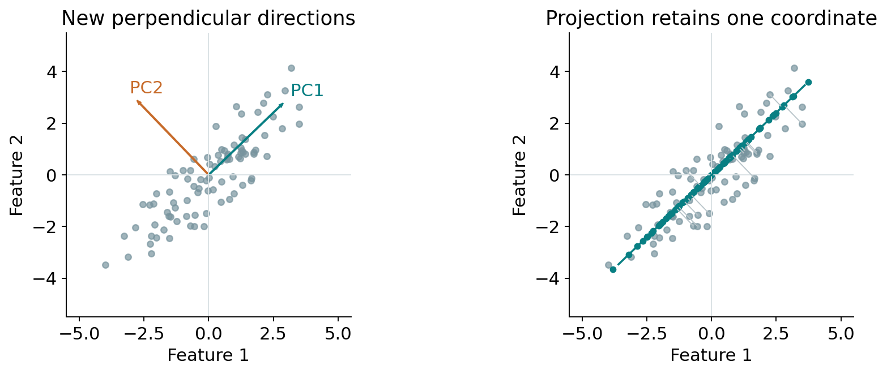{width="92%"}

PC1 maximizes the variance of projected coordinates. Later directions are perpendicular and capture remaining variance.

::: {.notes}
5:00-7:00. Explain the orange direction as PC2 and the teal direction as PC1. A projection retains coordinates along selected directions and loses the perpendicular information. This figure is an explicitly synthetic geometry example, not Titanic data. Sources: standard PCA geometry and scikit-learn PCA documentation.
:::

## Directions and point coordinates are different

**A component direction** gives a weight to each original feature.

**A component score** gives an observation's coordinate along that direction.

$$
z_{i1} = (x_i - \bar{x})^\top v_1
$$

All passengers use the same direction. Their feature values produce different coordinates.

::: {.notes}
7:00-8:00. This distinction prepares the SVD bridge. Feature weights live in the original p-dimensional space. Scores live with the n observations. Do not call U alone the plotted PCA coordinates. Source: PCA definition and scikit-learn components_/transform conventions.
:::

## SVD supplies the directions and coordinates

For the centered prepared matrix:

$$
X_c = U\Sigma V^\top
$$

$$
Z_k = X_c V_k = U_k\Sigma_k
$$

| Object | Role in this example |
|---|---|
| Columns of V | Component directions across the 12 features |
| First two columns of U multiplied by their singular values | Two coordinates for each of 891 passengers |
| First two columns of Z | The PCA scatterplot |

::: {.notes}
8:00-10:00. Use reduced SVD, so U is n by p, Sigma is p by p, and V is p by p for this n>p example. Retaining k=2 gives scores n by 2 and directions p by 2. sklearn stores the directions as rows of components_, so components_.T corresponds to V_k. A simultaneous sign flip in a direction and its scores does not change the geometry. The covariance/eigenvalue connection is in an optional appendix.
:::

## A small score calculation

Suppose a centered observation is **(2, 1)** and a component direction is **(1, 1) divided by the square root of 2**.

$$
z = \frac{2+1}{\sqrt{2}} \approx 2.12
$$

That is the observation's coordinate on this component.

What changes if we reverse the component's direction?

::: {.notes}
10:00-11:00. A short conceptual check. Reversing the direction changes the sign of the score and reflects the axis, with no new information. This is a toy numerical example, not a passenger. The observation must use the centered/prepared feature scale.
:::

## Two dimensions leave information out

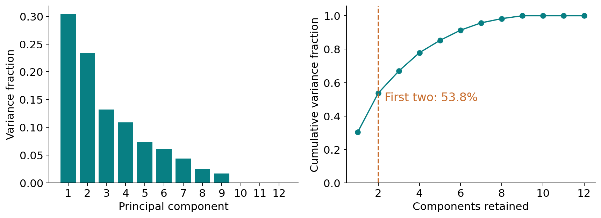{width="90%"}

The first two components retain **53.8% of prepared-feature variance** in this snapshot.

Variance retained does not measure how well we explain survival.

::: {.notes}
11:00-12:30. Point to the remaining components. Overlap in a two-dimensional view does not establish that no structure exists in the original features. Redundant one-hot columns produce some zero-variance directions. That detail is optional. Source: actual PCA fit on the supplied feature matrix using scikit-learn.
:::

## Component weights help interpret the axes

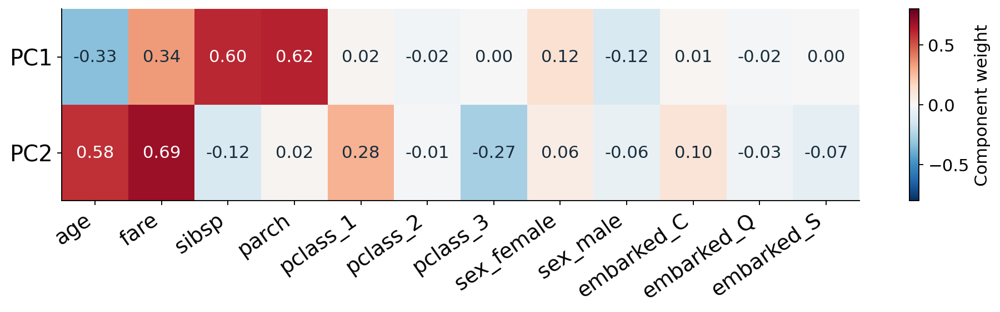{width="95%"}

Large absolute weights identify features contributing strongly to a direction.

Read the weights together with the original variables. Signs depend on axis orientation.

::: {.notes}
12:30-14:00. Pick one high-weight feature from the actual heatmap and explain how it contributes to a score. These are entries of V, or PCA.components_.T. Some sources use loading for scaled eigenvectors; call these component weights to avoid ambiguity. The outcome is absent from X. Source: the supplied PCA fit.
:::

## Scaling changes the directions PCA chooses

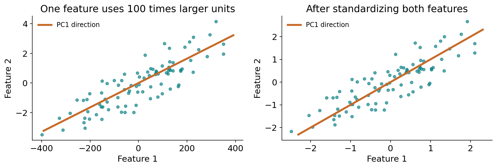{width="92%"}

PCA centers its input. It does not automatically standardize its columns.

::: {.notes}
14:00-16:00. The orange line shows the actual first principal direction in each feature scale. The observations are the same synthetic example with different units. Standardization is a modeling decision, not a ritual. A feature whose natural variance matters may deserve a different weighting. Sources: scikit-learn PCA and StandardScaler documentation.
:::

## Quick check: the most relevant direction

PCA finds a direction with large variance across passenger characteristics.

Does that guarantee it separates survivors from nonsurvivors?

What information would PCA need to optimize separation by survival?

::: {.notes}
16:00-17:00. Give 20 seconds with a partner. Answer: no guarantee. Survival is not an input or objective here. A supervised separation objective would be a different task. Keep the focus on EDA rather than introducing another algorithm.
:::

## t-SNE matches neighborhood similarities

1. Convert original distances into similarities, with a local scale around each point.
2. Represent similarities in the low-dimensional view using a heavy-tailed distribution.
3. Move points to make the two similarity patterns agree.

Perplexity controls an **effective neighborhood scale**. It is not an exact neighbor count.

::: {.notes}
17:00-20:00. Original affinities use adaptive Gaussian bandwidths, then symmetric probabilities. The embedding uses Student-t affinities. Optimization minimizes KL divergence and is nonconvex. The heavy tail helps address crowding. The mathematics can remain at this mechanism level, with an optional objective in the notebook/Sources. Source: https://scikit-learn.org/stable/modules/manifold.html#t-distributed-stochastic-neighbor-embedding-t-sne and van der Maaten and Hinton, 2008.
:::

## Perplexity changes the view

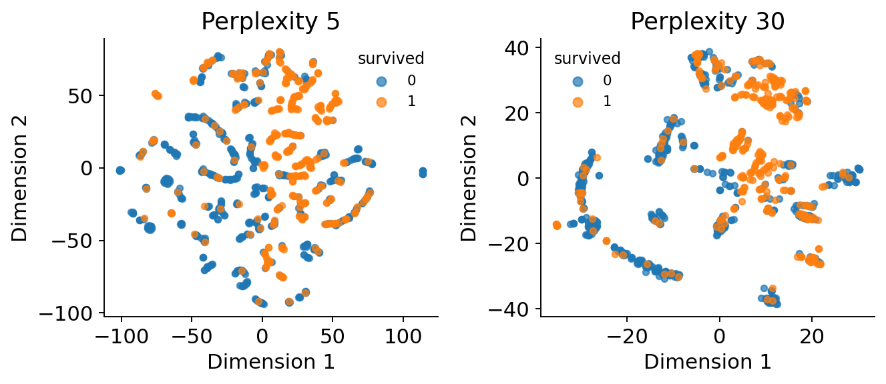{width="96%"}

The data, preparation, and coloring stay fixed. The neighborhood scale changes.

::: {.notes}
20:00-22:00. These are actual scikit-learn runs with max_iter=1000, init=pca, learning_rate=auto, random_state=42. Ask which interpretations persist. Avoid comparing raw axis coordinates or selecting the plot that gives the most attractive separation. Source: supplied parameter runs and scikit-learn t-SNE documentation.
:::

## A t-SNE island suggests a question

Which original features distinguish these observations?

Does the pattern persist with another reasonable setting or initialization?

Check the original variables before calling it a distinct group.

Island area, density, and between-island spacing need careful interpretation.

::: {.notes}
22:00-24:00. Do not teach that every isolated group is fake or that the view is useless. The point is to investigate what created the grouping and whether the interpretation survives checks. Global distances are not the t-SNE objective. Source: scikit-learn manifold learning guide and original t-SNE paper.
:::

## UMAP builds a weighted neighborhood graph

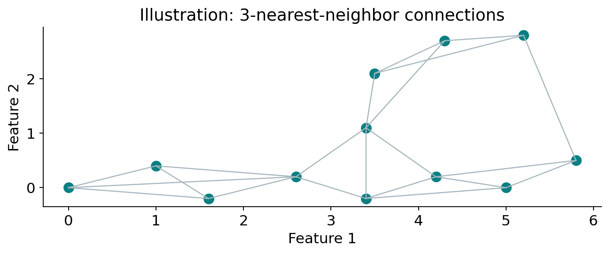{width="83%"}

UMAP adapts local distance scales, weights neighborhood connections, and optimizes a low-dimensional layout to represent them.

::: {.notes}
24:00-27:00. This figure is a simple 3-nearest-neighbor illustration, not the exact UMAP fuzzy graph. UMAP constructs locally scaled, weighted relationships and combines directed neighborhood memberships. Its layout uses attractive and repulsive terms. No topology derivation is required today. Source: https://umap-learn.readthedocs.io/en/latest/how_umap_works.html.
:::

## UMAP's parameters express different choices

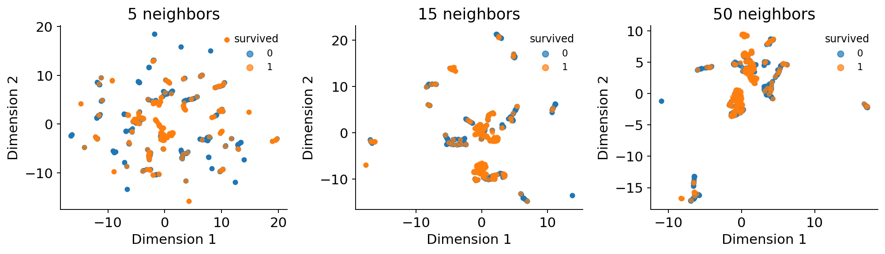{width="97%"}

**n_neighbors:** scale of the neighborhood context.

**min_dist:** how tightly the optimized layout tends to pack points.

::: {.notes}
27:00-30:00. min_dist influences the low-dimensional distance curve rather than imposing a literal hard lower bound on every point pair. The min_dist comparison is in the appendix and explorer. Low values can make groups look compact without proving stronger separation in original features. Saved runs use the official UMAP-js implementation, described in run_details.qmd; Python code uses umap-learn. Source: UMAP parameter documentation.
:::

## PHATE compares diffusion profiles

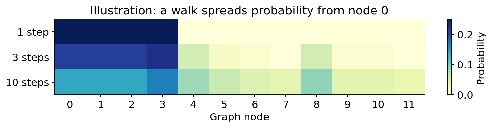{width="92%"}

PHATE builds a graph, diffuses through it, compares the resulting profiles, and lays out those relationships.

::: {.notes}
30:00-32:00. This is a toy random-walk illustration, not the exact PHATE kernel. PHATE uses a diffusion operator and potential distances, followed by a low-dimensional MDS layout. The intuition is that several paths through local neighborhoods can describe broader connectivity. No derivation today. Sources: Moon et al., 2019, and PHATE API documentation.
:::

## PHATE adds a useful exploratory view

Continuous patterns and transitions are useful structures to investigate.

**knn** controls neighborhood construction.

**t** controls diffusion smoothing. We use `t="auto"` for the main example.

Diffusion steps are not observed time. A branch in Titanic does not establish a passenger trajectory.

::: {.notes}
32:00-34:00. PHATE was developed in settings including biological transitions, but it can be used on other feature matrices. Smoothing can hide fine structure and outcomes depend on the representation and settings. knn=30 handles the repeated passenger profiles in this example without removing people or adding jitter. Both the actual PHATE plot and t sensitivity runs are available for exploration. Sources: https://phate.readthedocs.io/en/stable/api.html and Moon et al., 2019.
:::

## Live Titanic exploration

Open **`titanic_live_scaffold.ipynb`** in Positron.

Create or load the four representations, then choose one to inspect.

Keep the prepared data fixed while comparing methods.

Saved runs are supplied so we can spend time interpreting the results.

::: {.notes}
34:00-35:00. Setup and cached coordinates should already be loaded. The scaffold includes supplied helper code and fill-in method cells. Choose whether to recompute after installing the recompute extra. PCA can be fitted directly in either mode. Keep titanic_complete.ipynb open as reference. Pre-run Python UMAP before class if you will recompute, because numba compilation can be slow on first use.
:::

## Color is a tool for asking another question

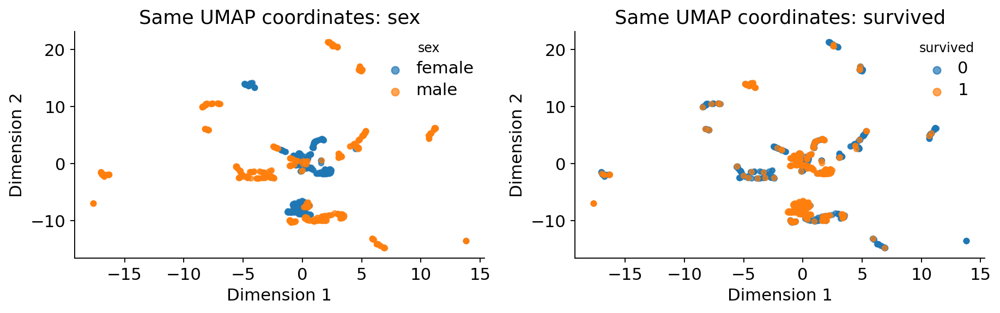{width="95%"}

Which overlays reflect inputs? Which add withheld information?

::: {.notes}
35:00-41:00, mostly in the notebook or browser explorer. Change only COLOR_BY, keeping coordinates fixed. Try sex, pclass, survived, and age_is_missing. An input overlay may explain how geometry was constructed. A withheld survival overlay suggests association questions. Missingness can reveal imputation effects without proving a missing-data mechanism. Source: supplied features, metadata, and saved coordinates.
:::

## An embedding leads back to the original data

Select a region and inspect the passengers behind it.

Compare their class, sex, fare, missingness, and survival with the remaining passengers.

Use an original-variable plot or table to investigate the explanation.

::: {.notes}
41:00-46:00. Use lasso/box selection in explorer.html or the reproducible region inspection in the completed notebook. A selected region is an inspection convenience, not a validated cluster. Follow up with the Day 1 class-by-sex survival table and explicit denominators. Ask a student to propose a next check. Geometric selection alone does not establish a causal story.
:::

## Different objectives create different views

| Method | Main construction | Useful interpretation |
|---|---|---|
| PCA | Linear projection retaining variance | Component weights and variance retained |
| t-SNE | Match neighborhood similarities | Local groupings to investigate |
| UMAP | Represent a weighted neighborhood graph | Neighborhood patterns at chosen scales |
| PHATE | Compare diffusion profiles | Smoother connectivity and continuous patterns |

Every view compresses information. The best next check depends on the question.

::: {.notes}
46:00-48:00. Do not rank methods by how separated the labels look. Return to the question and what information each objective preserves or distorts. The supplied four-method figure can be used after class as a comparison reference.
:::

## Exit check: how strong is the claim?

“This map shows three islands, so there are three kinds of passengers.”

What would you check before accepting that claim?

Name one original-variable comparison and one sensitivity check.

::: {.notes}
48:00-50:00. Expected: inspect original feature profiles and sample sizes, examine missingness/preparation, change a justified setting/seed, compare a different method or direct plot, and avoid treating a two-dimensional view as a clustering certificate. A stable view adds evidence without proving the claim. Ask students to state a next question in concrete terms.
:::

## Extra practice: tornado profiles

Open **`tornado_practice.ipynb`**.

Use the fixed 700-record sample. Construct profiles using transformed track size and starting location.

Overlay EF rating, which was withheld from the embedding inputs.

Then compare with the original size measurements. How does including geography change the meaning of similarity?

::: {.notes}
Optional, unscheduled. The original CSV covers 4,706 tracks from 2015-2018. The practice subset uses random_state=386, followed by stable ID ordering. Four features: standardized log1p length, log1p width, starting latitude and longitude. EF, outcomes and time are excluded. The completed version supplies all four methods. This is an exploratory sample, not a population risk estimate or precise geodesic-distance model.
:::

## Appendix: SVD and covariance eigenvectors

$$
\frac{X_c^\top X_c}{n-1} = V\frac{\Sigma^2}{n-1}V^\top
$$

$$
\lambda_j = \frac{\sigma_j^2}{n-1}
$$

The right singular vectors are covariance eigenvectors. Singular values determine the variance along each component.

::: {.notes}
Optional derivation for students with linear algebra. Substitute X_c=U Sigma V^T, use U^T U=I for reduced SVD, and identify eigenvalues/eigenvectors. This covariance is for the prepared and centered matrix. Feature transformations and scaling therefore matter.
:::

## Appendix: UMAP layout compactness

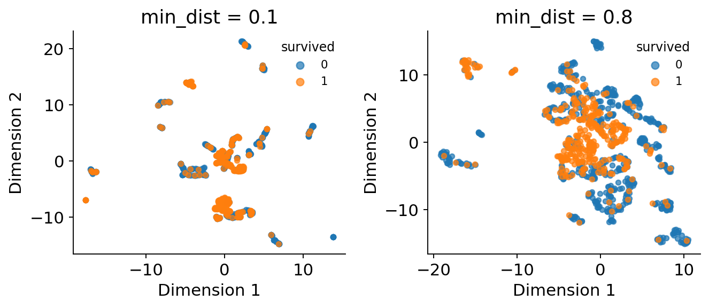{width="96%"}

Compactness in the layout depends partly on the parameter choice.

::: {.notes}
Optional sensitivity example using actual saved UMAP-js runs. Neither apparent density nor the size of a visual gap should be treated as a direct original-space measurement. Source: UMAP documentation and supplied run manifests.
:::

## Appendix: PHATE diffusion smoothing

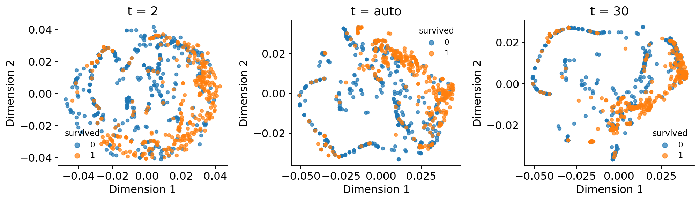{width="98%"}

The diffusion scale changes which patterns remain visible.

::: {.notes}
Optional. These are actual PHATE Python runs with knn=30 and smacof MDS. Small t retains more local variation, and larger t can oversmooth distinctions. The automatic value is data-adaptive. Diffusion time is not a passenger timestamp. Source: PHATE API and supplied runs.
:::

## Sources and run details

- [scikit-learn PCA](https://scikit-learn.org/stable/modules/generated/sklearn.decomposition.PCA.html)
- [scikit-learn t-SNE](https://scikit-learn.org/stable/modules/manifold.html#t-distributed-stochastic-neighbor-embedding-t-sne)
- [UMAP documentation](https://umap-learn.readthedocs.io/en/latest/)
- [PHATE documentation](https://phate.readthedocs.io/en/stable/)
- Moon et al. (2019), *Nature Biotechnology*, [doi:10.1038/s41587-019-0336-3](https://doi.org/10.1038/s41587-019-0336-3)

The website includes dataset preparation, exact settings, and saved-run provenance.

::: {.notes}
Reference only. Saved UMAP uses the official UMAP-js implementation and the recomputation notebook uses umap-learn. Python PCA/t-SNE and PHATE were executed during preparation. Changing method implementations or versions may change a layout. The Quarto source and source figures remain editable.
:::
